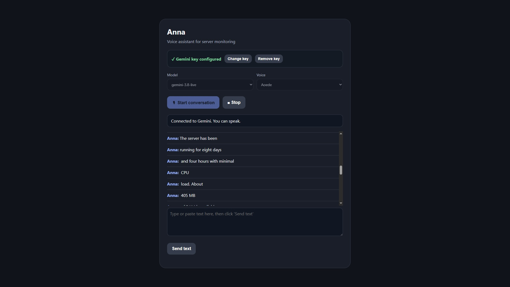

# Anna — self-hosted voice assistant for Gemini Live (developer edition)

A small server with a web interface for talking to [Gemini Live](https://ai.google.dev/)
by voice, with a plugin system for skills. Anna answers in the language the user
speaks to her.

This is the **developer edition**: you run it on your own machine or your own server
with **your own API key**. A separate desktop edition for end users is planned.

Not affiliated with Google. Gemini is a trademark of Google LLC.

📝 Write-up: [Streaming microphone audio to Gemini Live from a browser](https://dev.to/yankel_perelman_96a1f31a6/streaming-microphone-audio-to-gemini-live-from-a-browser-what-i-learned-building-a-small-voice-16m7)



## Features

- Real-time voice conversation in the browser (microphone → WebSocket → Gemini Live → speech)
- Enter your Gemini API key on the web page (validated against Google, stored with 0600 permissions)
- Model and voice drop-downs (the model list is fetched from Google and filtered to Live-capable models)
- Live transcripts of both sides in the page
- Built-in tools: web search (via the `ddgs` metasearch library, which queries several
  engines such as DuckDuckGo and Wikipedia) and optional Telegram messages
- **Skills**: drop a Python file into `skills/` and it is loaded at startup
- Included skill: **server monitoring** (`skills/server_monitor_skill.py`)
- Local conversation log in SQLite

## Scope

In this edition Anna is configured as a **server monitoring and administration
assistant**. The system prompt (`SYSTEM_INSTRUCTION` in `anna.py`) tells her to discuss
only the server: load, memory, disk, uptime, and how to diagnose or maintain it. She can
read live stats (monitoring skill), search the web for administration answers (for
example how to free up memory), and send a report or a found how-to to your Telegram
chat. She cannot run commands on the server, and she is told to warn about risky ones.
Everything else is politely declined. Edit the prompt to change her role.

A prompt is a soft guard, not a security boundary: a determined user may still talk the
model into off-topic answers (for example through the web search tool). If you need a hard
restriction, remove tools from `TOOLS` and the tool handler in `anna.py`.

## Quick start

```bash
git clone https://github.com/yankelperelman/anna-dev.git
cd anna-dev

python -m venv .venv
# Windows: .venv\Scripts\activate      Linux/macOS: source .venv/bin/activate
pip install -r requirements.txt

python anna.py
```

Open <http://127.0.0.1:8010>, paste your Gemini API key into the page, choose a model and
a voice, and press **Start conversation**. (Alternatively, put `GOOGLE_API_KEY` in a
`.env` file: copy `.env.example` to `.env`.)

Browsers only allow microphone access on `localhost` or over HTTPS. To use the
assistant on a remote server, either forward the port over SSH
(`ssh -L 8010:127.0.0.1:8010 user@your-server`) or put it behind an HTTPS reverse
proxy **with authentication** (see Security).

## Docker

```bash
docker compose up -d --build
```

Open <http://127.0.0.1:8010> and enter your key on the page (or provide `GOOGLE_API_KEY` in a
`.env` file). The port is published on localhost only. Logs:
`docker compose logs -f anna`.

- The conversation log and the key saved from the web page are kept in the `anna-data` volume.
- `./skills` is mounted read-only into the container, so you can add or edit skills
  and just restart (`docker compose restart anna`).
- **Server monitoring inside Docker:** the included skill reads CPU load, RAM and
  uptime from `/proc`, which a container shares with the host kernel, so those
  numbers describe the host. Disk usage describes the filesystem the skill is pointed at
  (`/` inside the container, usually the disk holding Docker's data). To report another
  disk, mount it into the container and set `ANNA_MONITOR_DISK_PATH`. Note that
  container memory limits are not reflected in these numbers.

## Configuration

All settings come from environment variables or a `.env` file.

| Variable | Required | Default | Description |
| --- | --- | --- | --- |
| `GOOGLE_API_KEY` | no | — | Your Gemini API key (or enter it on the web page; a saved key wins) |
| `ANNA_KEY_FILE` | no | `gemini_key.txt` | Where a key entered on the web page is stored |
| `GEMINI_MODEL` | no | `gemini-3.8-live` | Default model (selectable on the page) |
| `ANNA_VOICE` | no | `Puck` | Default voice (selectable on the page) |
| `ANNA_HOST` | no | `127.0.0.1` | Bind address |
| `ANNA_PORT` | no | `8010` | Port |
| `ANNA_DB_PATH` | no | `anna_history.sqlite3` | Local conversation log |
| `ANNA_MONITOR_DISK_PATH` | no | `/` | Disk reported by the server monitoring skill |
| `ANNA_ACCESS_TOKEN` | no | — | Secret for a publicly reachable server; open `https://host/?token=...` once per browser |
| `ANNA_ALLOWED_HOSTS` | no | — | Your domain(s) when a reverse proxy rewrites the `Host` header |
| `ANNA_SEARCH_REGION` | no | `wt-wt` | Region for web search results (`wt-wt` = no bias, e.g. `us-en`, `ru-ru`) |
| `TELEGRAM_BOT_TOKEN` | no | — | Enables the Telegram tool |
| `TELEGRAM_CHAT_ID` | no | — | Target chat for the Telegram tool |

## Skills

Skills live in the `skills/` folder and are loaded by `SkillRegistry` when the server
starts. Each skill can add tools (function declarations) and extra instructions for
the model. Use `skills/server_monitor_skill.py` as a reference when writing your own.

## Security

- **By default there is no authentication**, and the server listens on `127.0.0.1` only.
  If you publish it on a domain (reverse proxy with HTTPS), **set `ANNA_ACCESS_TOKEN`**:
  without it anyone on the internet can talk to Anna, spend your API key, and replace or
  remove the saved key. With a token, open `https://your-domain/?token=...` once in each
  browser; a cookie is stored and the token disappears from the address bar. The token ends
  up in your proxy's access log, so treat it like a password and change it if it leaks.
  Your proxy must forward WebSocket connections (`Upgrade` headers).
- Requests from other websites are rejected (Origin check). If your proxy rewrites the
  `Host` header, add your domain to `ANNA_ALLOWED_HOSTS`.
- The API key itself is never sent back to the browser.
- Web search queries are sent to third-party search engines and appear in the server log.
- Never commit your `.env` or `gemini_key.txt`. If a key was ever committed, treat it as leaked and revoke it.
- Conversation transcripts are stored locally in the SQLite file. It is git-ignored;
  keep it that way.
- The server monitoring skill lets the model read information about your server.
  What the model sees is sent to Google. Do not use it with data you are not allowed
  to share.

## Google API terms — please read

You are responsible for complying with the current
[Gemini API Additional Terms of Service](https://ai.google.dev/gemini/terms).
Points that matter for this project (summary, not legal advice):

- **Available regions only.** Use the API only from regions where Google offers it.
  This project does not support, and must not be used for, bypassing regional restrictions.
- **18+.** You must be an adult; do not make this app available to minors.
- **Free tier and data.** On the unpaid tier Google may use your prompts and
  responses (including audio) to improve its products, and human reviewers may read them.
  Do not send sensitive, confidential or personal information on a free key.
- **EEA, Switzerland, UK.** If you make the app available to users there, only paid
  (billing-enabled) services may be used.
- **Your own key, your own use.** This edition is meant for developers running it
  for themselves. Do not share your key or give other people access to your instance.

Voices and models are offered as Google lists them; a voice that the chosen model does not
support makes the session fail with an error, in which case pick another one.

Terms change; check them before you rely on this summary.

## Roadmap

- Desktop edition for end users (installer, bring-your-own **paid** key)
- Additional providers (Vertex AI, OpenAI Realtime) behind a common interface
- Authentication for the web interface
- More skills

## Articles

- [Streaming microphone audio to Gemini Live from a browser: what I learned building a small voice assistant](https://dev.to/yankel_perelman_96a1f31a6/streaming-microphone-audio-to-gemini-live-from-a-browser-what-i-learned-building-a-small-voice-16m7)

## License

MIT — see [LICENSE](LICENSE).
